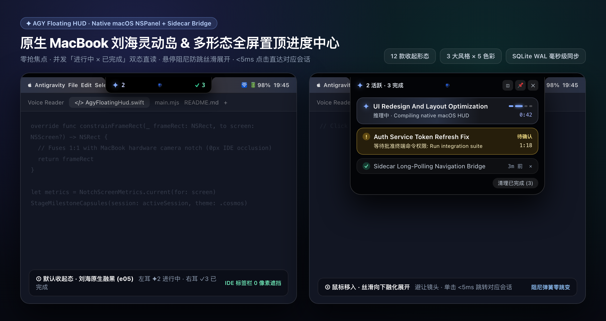
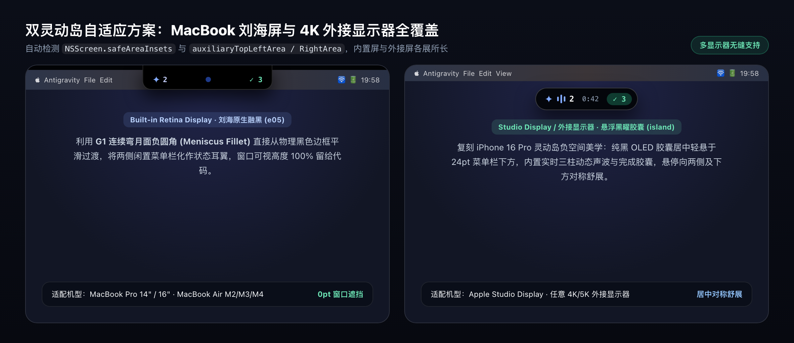
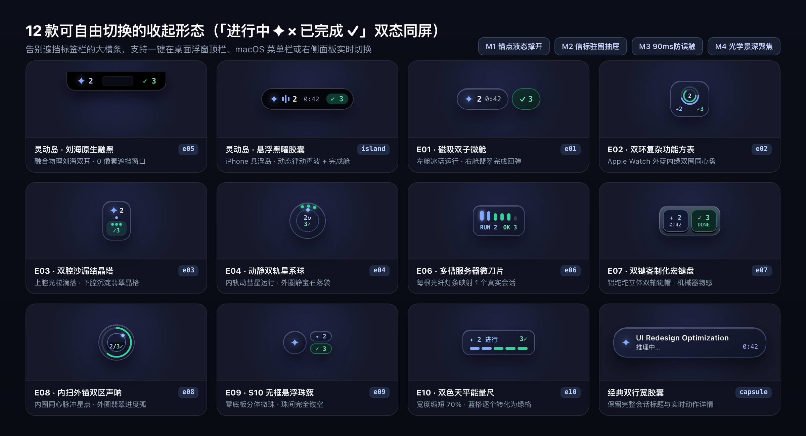
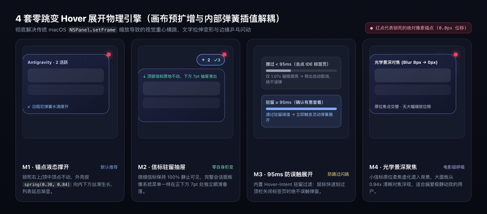
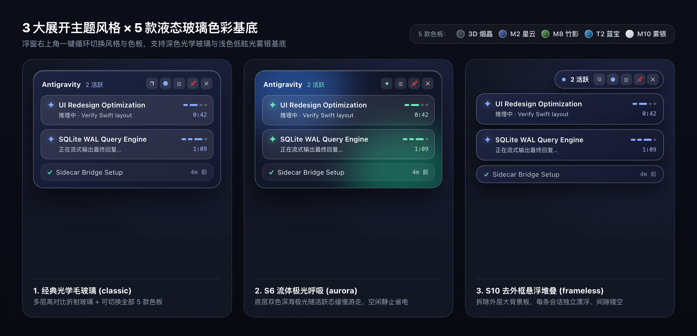
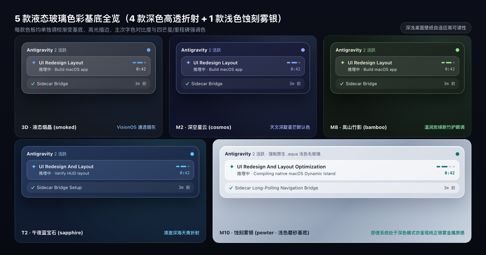
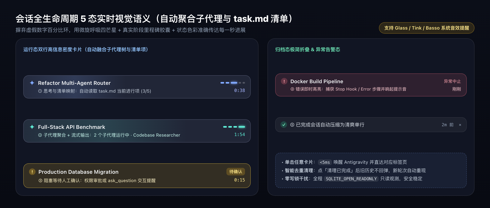
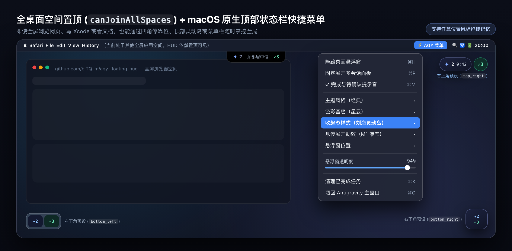
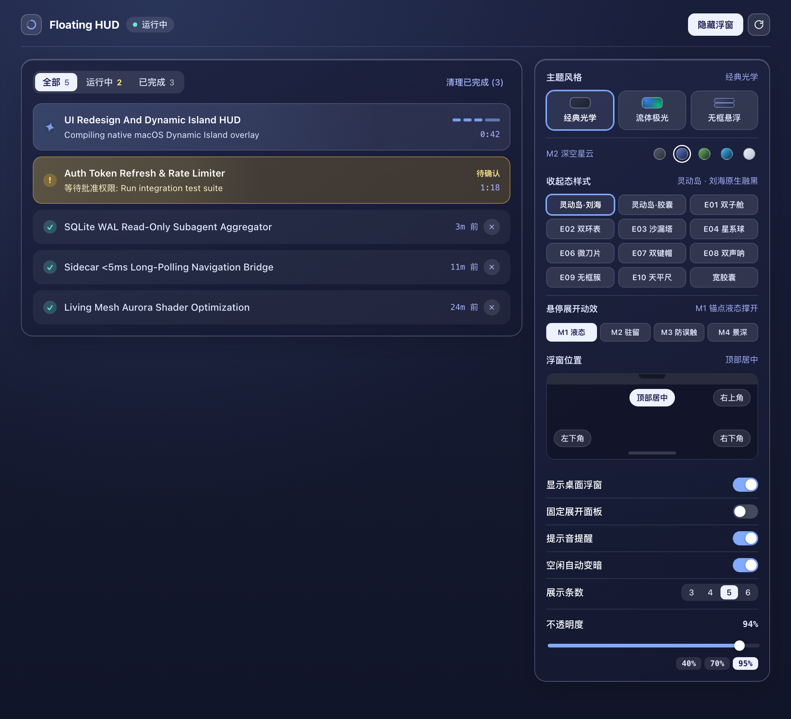
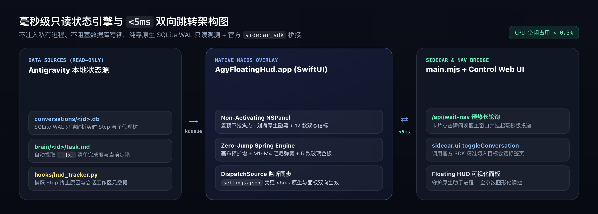

# AGY Floating HUD — Antigravity 2.0 桌面灵动岛与多形态进度悬浮窗

专为 **Antigravity 2.0 Desktop (macOS)** 打造的全屏置顶多会话实时进度与完成提醒插件。即使你切到浏览器、终端、Xcode 或全屏应用，也能通过屏幕顶部的**原生刘海灵动岛**或屏幕角落的**双态微缩信标 (`NSPanel`)** 一瞥掌握所有并发 Agent 会话的实时动态。



---

## 视觉总览与核心特性

### 1. 双灵动岛自适应方案（MacBook 刘海屏 + 4K 外接显示器全覆盖）
自动检测 `NSScreen.safeAreaInsets` 与 `auxiliaryTopLeftArea / RightArea` 硬件几何边界，在内置刘海屏与无刘海外接显示器上自动呈现最佳原生形态：



- **`灵动岛 · 刘海原生融黑` (`e05`，默认)**：通过 G1 连续弯月面负圆角与对称外扩同心黑框包覆物理刘海——左耳展示 `✦ 进行中数`，右耳展示 `✓ 已完成数`，壳体以外区域 100% 鼠标穿透；鼠标移入先触发 `0ms` 液态微张蓄力，驻留满 `180ms` 无缝衔接展开为纯黑 OLED 灵动岛面板；按住往下或往外接显示器一拽即可自动摘下化为悬浮胶囊，拖回刘海附近松手自动磁吸归位。
- **`灵动岛 · 悬浮黑曜胶囊` (`island`)**：复刻 iPhone 16 Pro 灵动岛负空间美学，纯黑胶囊轻悬于桌面，内置呼吸四芒星、3 柱动态律动声波、实时耗时与翡翠完成胶囊，支持跨多显示器任意位置拖拽与刘海磁吸停靠。

---

### 2. 12 款可自由切换的「进行中 × 已完成」双态收起形态
针对多 Agent 并发场景同时呈现 **「进行中 (`✦`) × 已完成 (`✓`)」** 双通道信息，高密度磨砂基底彻底杜绝底层标签文字透底重影，后台任务完成瞬间自动触发翡翠微光回弹反馈：



- **微缩器物与仪表信标 (`E01` – `E10`)**：
  - `E01 磁吸双子微舱` (`e01`) · `E02 双环复杂方表` (`e02`) · `E03 双腔沙漏晶塔` (`e03`)
  - `E04 动静双轨星系` (`e04`) · `E06 多槽微刀片架` (`e06`，1 根光纤灯条对应 1 个真实会话) · `E07 双键客制键盘` (`e07`)
  - `E08 内扫外锚声呐` (`e08`) · `E09 无框悬浮珠簇` (`e09`) · `E10 双色天平光尺` (`e10`) · `经典双行宽胶囊` (`capsule`)

---

### 3. 120Hz 单壳体液态变形与可调防误触预热引擎 (`M1` – `M4`)
采用恒定 `500×600` 像素级热区穿透画布（零 `NSPanel.setFrame` 缩放抖动、零视图树销毁重建）与双轴简谐弹簧速度无缝交接（`100ms / 180ms / 320ms / 500ms` 四档预热驻留可调 + `220ms` 移出宽限期），锁死锚点绝对像素顶点：



- **`M1 锚点液态撑开` (`m1`，默认)**：锁死角落顶点，沿阻尼弹簧如水滴般无缝放大展开。
- **`M2 信标驻留·抽屉浮现` (`m2`)**：收起信标原地纹丝不动，完整会话面板作为独立抽屉从正下方 `7pt` 处顺滑垂落。
- **`M3 90ms防误触·灵动展开` (`m3`)**：内置 `95ms` 悬停驻留判定，过滤鼠标快速划过标签栏时的无意擦碰。
- **`M4 光学景深聚焦` (`m4`)**：原位柔焦退入景深与清晰对焦切换，零位移感。

---

### 4. 3 大展开主题风格 × 5 款液态玻璃色彩基底





- **3 种主题风格 (`styleMode`)**：
  - **`经典光学毛玻璃` (`classic`)**：多层高对比折射毛玻璃卡片，支持切换全部 5 款色板。
  - **`S6 流体极光呼吸` (`aurora`)**：磨砂玻璃底层内嵌深海蓝与极光翠绿双色光团，有活跃任务时柔和缓慢游走，空闲时自动静止省电。
  - **`S10 去外框悬浮堆叠` (`frameless`)**：拆除最外层大矩形底板，每条会话作为独立毛玻璃胶囊直接漂浮于桌面之上，间隙完全镂空。
- **5 款精调色彩基底 (`theme`)**：
  - `3D 液态烟晶` (`smoked`) · `M2 深空星云` (`cosmos`) · `M8 岚山竹影` (`bamboo`) · `T2 午夜蓝宝石` (`sapphire`) · `M10 蚀刻雾银` (`pewter`，强制原生 `.aqua` 浅色低眩光磨砂基底)。

---

### 5. 会话全生命周期 5 态卡片解剖 & 跨全屏空间置顶调控





---

### 6. Antigravity 右侧可视化控制中心 & 毫秒级双引擎架构





- **SQLite WAL 实时只读引擎 (`conversations/<id>.db`)**：以 `SQLITE_OPEN_READONLY` + `PRAGMA query_only = ON` 直接读取 Antigravity 实时会话库与子代理树（自动聚合父子会话进度，避免 `transcript.jsonl` 跨轮次延迟导致状态滞后）。
- **点击卡片 `<5ms` 精准跳转**：结合 `nonactivatingPanel` 首次点击穿透 (`acceptsFirstMouse`) 与官方 `sidecar_sdk` (`window.sidecar.ui.toggleConversation`) 预热长轮询桥接，点击任意会话卡片立即激活 Antigravity 并切到对应会话标签页。
- **三端实时联动调控**：支持在 **桌面悬浮窗顶栏图标按钮**、**macOS 顶部状态栏菜单** 与 **Antigravity 右侧 `Floating HUD` 控制面板** 实时同步切换全部外观、形态、动效、不透明度与提示音设置。

---

## 快速安装与启动

```bash
git clone https://github.com/biTQ-m/agy-floating-hud.git
cd agy-floating-hud
chmod +x ./install.sh
./install.sh
```

常用参数：
- `./install.sh --rebuild`：强制重新编译并签名 `macos/AgyFloatingHud.app`
- `./install.sh --copy`：使用复制模式而非软链接安装到 `~/.gemini/config/plugins/agy-floating-hud`
- `./install.sh --uninstall`：退出悬浮窗进程并移除插件链接

## 运行单元测试

```bash
python3 -m unittest discover -s tests
```
